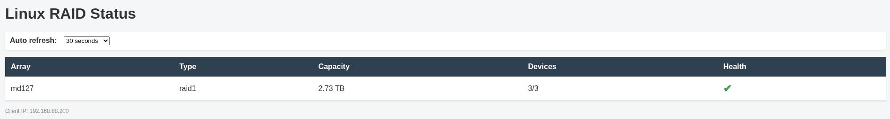

# mdspy

A web interface to show mdadm status



## Docker Usage

The application can be run using Docker.

### Pulling a pre‑built image

You can also pull a pre‑built image from GitHub Container Registry:

```bash
docker pull ghcr.io/galagithub/mdspy:latest
```

The image is built for amd64, arm64, and arm/v7 (Raspberry Pi or similar boards).

### Using Docker Compose

```bash
docker compose up -d
```

The service will be available at `http://localhost:8080`.

### Using the Dockerfile directly

Build the image:

```bash
docker build -t mdspy .
```

Run the container:

```bash
docker run -d -p 8080:80 --name mdspy mdspy
```

The application will be accessible at `http://localhost:8080`.

### Volumes

The container mounts the host's RAID status and block devices read‑only:

- `/proc/mdstat` → `/host/proc/mdstat`
- `/sys/block` → `/host/sys/block`

These are defined in `docker-compose.yml` and the `Dockerfile` setup.


